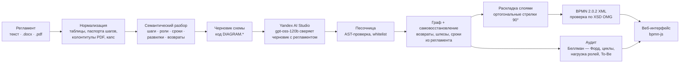

# ⚡ Архитектор BPMN-диаграмм — ПАО «Интер РАО»


-2E7D32)


**Регламент на русском языке → валидная схема BPMN 2.0.2 → аудит процесса и предложение To-Be.**
Решение трека «Архитектор BPMN-диаграмм» хакатона «ИИ-ассистенты для энергетики». Заказчик — Дирекция бизнес-архитектуры ПАО «Интер РАО».

### 🌐 Живое демо: https://bpmn-arch-kirillhakaton2026.msk1.amvera.tech
Российский хостинг (Amvera), открывается без VPN. Генерация по умолчанию — **Yandex AI Studio, модель gpt-oss-120b**.

---

## 🧭 Слепая проверка: 3 шага

1. **Откройте демо** и выберите регламент в списке «Готовый отраслевой регламент» — или **вставьте свой текст**, или **загрузите файл** `.docx` / `.pdf` / `.txt`. Подходит нумерованный список, сплошной текст, таблица шагов из Word, карточки шагов в стиле Business Studio («Шаг 4.1 · Ответственный · Длительность · Входы · Выходы»).
2. Нажмите **«Сгенерировать BPMN 2.0»**. Появится схема: роли по дорожкам, развилки, циклы возврата (красные стрелки), отказные ветки (красный «стоп»). Ниже — аудит: критический путь, срок с возвратами, нагрузка ролей, качество нотации; вкладки **To-Be**, **RACI**, **Инспектор**; панель **🛡️ AI Guardrails** — какие проверки прошёл граф.
3. **Скачайте результат:** `⬇️ BPMN 2.0` (открывается на [demo.bpmn.io](https://demo.bpmn.io)), SVG, паспорт процесса `.md`, регламент `.docx`. Флажок **«Отображать артефакты данных»** добавляет документы и системы под задачами — и в схему на экране, и в скачиваемый `.bpmn`.

> Движок можно переключить: **Yandex AI Studio** (по умолчанию) · **Облако** (та же gpt-oss-120b у Groq / OpenRouter) · **Офлайн-эмулятор** (без сети).

---

## 🏗 Как это устроено: гибридный конвейер

Нейросеть не рисует схему «в лоб» — она отвечает за понимание текста, а структуру, геометрию и проверку берёт на себя детерминированный движок.



1. **Нормализация** приводит любой ввод к шагам: таблицы Word («№ | Действие | Исполнитель | Срок»), карточки Business Studio, многоуровневую нумерацию, текст одной строкой или капсом, мусор PDF и строки рецензирования Word.
2. **Семантический разбор** строит чертёж процесса: роли, сроки, условия «если… иначе…», возвраты «вернуть на п.N», параллельные работы, этапы, условные действия и отказные ветки.
3. **Модель** (gpt-oss-120b в Yandex AI Studio) получает черновик и текст и правит смысл: роли, названия, условия, этапы. Контракт промпта рассчитан на лимит запроса, рассуждения — `reasoning_effort=low`.
4. **Движок** исполняет код модели в песочнице, проверяет граф (старт и финал, тупики, шлюзы, все возвраты регламента на месте), возвращает сроки из регламента, раскладывает схему и проверяет XML по официальной XSD. Невалидный XML пользователю не отдаётся.

---

## ✅ Качество — измерено

| Проверка | Результат |
| --- | --- |
| XSD BPMN 2.0 (официальная схема OMG, `schemas/BPMN20.xsd`) | каждый файл перед выдачей; невалидный — не отдаётся |
| Стресс-набор `stress_tests/` — 35 «диких» регламентов + 4 примера | **37/37 схем валидны** (XSD + геометрия), 2 мусорных текста — понятная ошибка, 0 падений |
| Тот же набор через Yandex AI Studio (gpt-oss-120b) | **37/37 собрала модель**, 2–12 с на схему |
| Автотесты (`pytest`) + `test_enterprise_pack.py` | **134 passed** + сквозной сценарий |
| Геометрия (`validate_bpmn.py`) | 0 диагоналей, 0 наложений блоков, 0 пересечений блоков стрелками, 0 коллизий подписей |
| Пример кейсодателя (паспорт «Этап 4», Business Studio) | 3 роли, 3 задачи × 16 ч, критический путь 48 ч, качество нотации 100% |

Что входит в стресс-набор: опечатки, обрыв текста, таблицы 223-ФЗ из Word, табуляция, паспорта с другими полями, смешанная нумерация, английский, капс, регламент без ролей и из одного шага, повтор номеров, ссылка на несуществующий пункт, тройная параллель, трёхсторонняя развилка, сроки в месяцах и сутках, спецсимволы `< > & "`, 60 шагов, роли с уточнениями, текст одной строкой, римские разделы, попытка промпт-инъекции.

---

## 🧩 Возможности

| Возможность | Как реализовано |
| --- | --- |
| Дорожки по ролям | Пул процесса, каждая задача — в дорожке исполнителя; роли из текста, а не из шаблона |
| Типы задач | userTask — человек в системе или согласование; scriptTask — операция системы; manualTask — физическая работа на объекте |
| Развилки и возвраты | XOR с подписанными условиями, AND split/join, циклы «на доработку» красными стрелками |
| Отказные ветки | Отказ, брак, вето посреди процесса — `endEvent` с `terminateEventDefinition` в дорожке проверяющего; успех — в общий финал |
| Подпроцессы | Этап, названный в регламенте, — раскрытый подпроцесс |
| Артефакты данных (по флажку) | `dataObjectReference` / `dataStoreReference` под задачами; входы — стрелкой в задачу, выходы — из задачи; не больше 6 (у паспортов — 14) |
| Аудит | Критический путь (Беллман — Форд), срок с возвратами, стоимость каждого цикла, нагрузка ролей, ИТ-системы и документы |
| To-Be | Параллельность независимых шагов, эскалация вместо циклов, ЭДО для согласований (как допущение); стоп-лист охраны труда — наряд-допуск и инструктаж не параллелятся |
| Честные метрики | «Соответствие регламенту» = доля перенесённых шагов / ролей / развилок / возвратов; «Обоснованность» — формула показана под цифрами |
| AI Guardrails | 7 проверок графа, что исправлено на лету, какие ответы модели отклонены и почему |
| RACI | R — ответственный, «Участвуют» из паспорта шага — C |
| Экспорт | `.bpmn`, `.svg`, паспорт процесса `.md`, регламент `.docx` |
| Ассистент | Чат по процессу: объясняет узкие места, правит регламент командой («Добавь согласование с экологами после шага 3») с перестроением схемы |
| MCP-сервер | `mcp_server.py` — генерация, аудит и ИТ-ландшафт как инструменты для корпоративных ИИ-агентов (JSON-RPC 2.0, stdio) |

---

## 🛡 Надёжность и безопасность

- **Цепочка движков:** Yandex AI Studio (gpt-oss-120b) → запасная модель Яндекса (yandexgpt-5.1) → открытые облака (Groq, OpenRouter) → встроенный эмулятор без сети. Исключения наружу не выходят, выбранный движок и причины видны в «Служебном».
- **Песочница:** код модели проходит AST-проверку — запрещены `import`, `open`, `eval`, `exec`, dunder-атрибуты, `while`; разрешены только методы `DIAGRAM.*`. Таймаут исполнения.
- **Промпт-инъекции:** фразы-обращения к ИИ внутри регламента («игнорируй инструкции…», `import os`, `rm -rf`) вырезаются до разбора и до отправки модели.
- **Защита от галлюцинаций:** модель не может «потерять» возврат или роль — такой ответ отклоняется и уходит на исправление; сроки шагов берутся из регламента; вариант To-Be от модели отклоняется, если он убрал роль, свернул шаги или занизил сроки.
- **Мусорный ввод** — понятное сообщение, а не выдуманная схема.

---

## 🤖 Модели и правила хакатона

- Основной контур — **Yandex AI Studio** (стек технологического партнёра): модель `gpt-oss-120b` с открытыми весами (Apache 2.0), запасная `yandexgpt-5.1`.
- Альтернатива в интерфейсе — та же открытая `gpt-oss-120b` у Groq / OpenRouter; офлайн — встроенный эмулятор. Проприетарные модели (ChatGPT, Gemini) не используются.
- `OPENAI_*` в настройках — название формата API (OpenAI-совместимый протокол), к сервисам OpenAI решение не обращается.

---

## 🚀 Локальный запуск

```bash
python3 -m venv .venv && source .venv/bin/activate
pip install -r requirements.txt
cp .streamlit/secrets.toml.example .streamlit/secrets.toml   # ключи по желанию; без ключей — эмулятор
streamlit run app.py                                          # http://localhost:8501
```

Проверки без интерфейса:

```bash
python3 -m pytest -q                                  # 134 автотеста
BPMN_AI_MODE=emulator python3 test_enterprise_pack.py # сквозной сценарий
python3 stress_test.py stress_tests/*.txt examples/*.txt   # отчёт: stress_tests/out/report.md
python3 stress_test.py --llm                          # то же через модель (ключи из secrets.toml)
python3 validate_bpmn.py examples/*.bpmn              # XSD + геометрия, код 0 = OK
python3 build_examples.py                             # пересборка эталонов examples/*.bpmn
python3 mcp_server.py                                 # MCP-сервер (stdio)
```

### Настройки (`.streamlit/secrets.toml` или переменные окружения)

| Переменная | Назначение |
| --- | --- |
| `YANDEX_API_KEY`, `YANDEX_FOLDER_ID` | Yandex AI Studio: ключ сервисного аккаунта (роль `ai.languageModels.user`) и каталог |
| `YANDEX_MODEL` | `gpt-oss-120b/latest` (по умолчанию в нашем развёртывании), `yandexgpt-5.1/latest` и др. |
| `YANDEX_REASONING_EFFORT` | `low` — ответ gpt-oss примерно вдвое быстрее |
| `YANDEX_FALLBACK_MODEL` | запасная модель того же каталога |
| `OPENAI_*`, `FALLBACK*_*` | OpenAI-совместимые облака с открытыми моделями (Groq, OpenRouter) |
| `BPMN_PROVIDER` | `auto` · `yandex` · `cloud` · `emulator` |
| `BPMN_TOBE_LLM=1` | дополнительно спрашивать To-Be у модели (по умолчанию To-Be строит локальный оптимизатор) |

Полный шаблон — `.streamlit/secrets.toml.example`.

### Развёртывание

Демо работает на **Amvera** (Docker, порт 8501): ветка `amvera` = код + `amvera.yml`; ключи — в секретах проекта (`SECRETS_TOML`); выкладка — `git push amvera amvera:master`.

---

## 📁 Структура

| Файл | Роль |
| --- | --- |
| `app.py` | Веб-интерфейс (Streamlit + bpmn-js): генерация, аудит, To-Be, RACI, инспектор, Guardrails, экспорт |
| `ai_generator.py` | Конвейер `generate_bpmn_from_text`, разбор регламента, песочница, To-Be, ассистент, экспорт |
| `process_blueprint.py` | Семантический чертёж процесса: шаги, развилки, возвраты (откат / исправление / завершение), этапы |
| `passport_regulation.py` | Форматы ввода: паспорта шагов, таблицы Word, одна строка, капс, рецензирование Word, промпт-инъекции |
| `bpmn_framework.py` | API песочницы `DIAGRAM.*`, граф, раскладка, ортогональный роутинг, XML, аудит |
| `bpmn_artifacts.py` | Слой артефактов данных (документы и системы) |
| `bpmn_quality.py` | Метрики: соответствие регламенту, обоснованность, зрелость, визуальная оценка |
| `llm_providers.py` | Провайдеры моделей: Yandex AI Studio, OpenAI-совместимые облака, бюджет промпта |
| `validate_bpmn.py` | Независимая проверка: XSD OMG + геометрия |
| `examples/`, `stress_tests/` | 4 эталонных регламента с результатами, 35 стресс-регламентов |

---

## ⚠️ Ограничения

| Ограничение | Комментарий |
| --- | --- |
| Один пул без message flow | Внешние организации — отдельными дорожками |
| Нет таймеров, граничных событий и сообщений | Сроки учитываются в аудите, а не в нотации |
| Время ответа на демо-сервере 15–30 с | Основное время — ответ модели на 120 млрд параметров и вычисления на облачном сервере; на рабочей машине — около 10 с |
| Регламенты на английском | Разбираются, но названия задач не по русскому стандарту «глагол + объект» |
| Сканы PDF без текстового слоя | Не распознаются: нужен PDF с текстом или .docx |
| Схема не исполняемая | По условию задачи результат — модель для системы моделирования корпоративной архитектуры |

📄 Подробнее о возможностях и ограничениях: [POSSIBILITIES_AND_LIMITATIONS.md](POSSIBILITIES_AND_LIMITATIONS.md)
